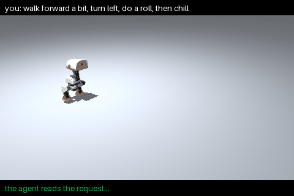

<p align="center"></p>

<h1 align="center">strands-robots</h1>

<p align="center"><b>A world. A robot. A brain.</b><br>
Robots your agents can drive, in sim and for real.</p>

<p align="center"></p>

## The idea

There are three things, and that's the whole library:

- a **`Simulation`** is the world (MuJoCo here; Isaac Sim and Newton on a GPU),
- a **`Robot`** is a body in that world, or on your desk,
- a **`Policy`** is the brain that decides what the body does next.

<!-- test: network -->
```python
from strands_robots import Policy, Robot

duck = Robot("microduck")
duck.run(Policy("microduck?vx=0.3"), seconds=10)   # it walks about 1.3 m
```

## What that unlocks

**🤖 Any robot, by name.** 76 robots in the registry (arms, hands, humanoids, quadrupeds, a duck), MuJoCo Menagerie
and `robot_descriptions` models, or your own MJCF/URDF. `Robot("g1")`, `Robot("panda")`, `Robot("my_arm.xml")`: same
verbs for all of them, and on a USB port the same `Robot` drives a real SO-101.

**🌍 Worlds an agent can build.** `sim.tool` lets an agent add robots, objects and cameras, step time and look at
the result. Describe a scene in words and the agent can put it together, then run policies in it.

**🧠 Any brain, here or there.** Your own function, an ONNX skill, or any LeRobot checkpoint: in your process, or
served from a GPU across the room over Zenoh. 13 LeRobot policy families measured driving our robots, same actions
locally and served.

**📼 Every episode is a dataset.** Add `record=` to a run and you get a LeRobot v3 dataset, in sim or on a real arm
(it's the same loop). Collect, train, run the new policy, repeat.

**🕸️ Robots that find each other.** Put them on a mesh and they discover one another with zero setup, take commands
from anywhere, stream their state, and all stop on one e-stop. Hand the whole room to an agent with `mesh.tool`.

**🛑 Safe enough to share.** Every robot generates its own manifest, checks every outside command through one safety
chain, and has an e-stop that stops it in ~10 ms and can't be overridden.

## Talk to it

```python
from strands import Agent

Agent(tools=[duck.tool])("walk forward a bit, turn left, do a roll, then chill")
```

The agent picks skills (Pollen Robotics' open microduck policies), the skills move the motors, the loop keeps it
safe. That GIF up top is a real Claude turn doing exactly this.

The same works for a world the agent builds itself: [`notebooks/examples/agent_builds_a_scene.py`](notebooks/examples/agent_builds_a_scene.py)
hands `sim.tool` and `arm.tool` to one agent, which places three cubes and a camera, moves the arm and looks at the result.

## What's in the box

| | |
|---|---|
| 🧠 **Any policy, any robot** | a function you write, an ONNX skill, or any LeRobot checkpoint, on whichever robot it was made for; joints, cameras and units are matched for you, and a mismatch is refused by name before anything moves |
| 🤖 **LeRobot, natively** | in your process, or served from a GPU over Zenoh: 13 policy families measured driving our robots |
| 🛑 **Safety** | a generated manifest, one safety chain for every outside command, an e-stop in ~10 ms |
| 🕸️ **Mesh** | robots find each other on a LAN with zero setup (or over AWS IoT), one call stops them all |
| 📼 **Recording** | `run(record=...)` writes LeRobot v3 datasets |
| 🖥️ **Dashboard** | the world in a browser tab, with a live 3D twin, sliders, chat and e-stops |
| 🪶 **Small** | ~10,600 lines of Python, no file over 250; the v0.5 it replaces was 258,000 |

## Try it

```bash
uv venv -p 3.12 && source .venv/bin/activate
uv pip install -e ".[all]"
uv pip install "lerobot[remote,feetech,dataset] @ git+https://github.com/huggingface/lerobot@53feaef37b67e8f4c23b6953e880ff535e39d6fe"  # LeRobot main
pytest -q tests
```

Then read along:

- **Docs:** [`docs/`](docs/), the site for v1 (`pip install -r docs/requirements.txt && mkdocs serve`, then open
  http://127.0.0.1:8000). Start a dashboard on port 8090 and the home page shows it live.
- **Notebooks:** [`notebooks/`](notebooks/) walks one arm from "hello robot" to "an agent drives it over the mesh".
  They're saved with their videos, so you can just read them.
- **Status:** [`docs/status.md`](docs/status.md) lists every part, its gate, and what still needs a real arm.

## Where it's going

v1 is built on this `dev` branch, one pull request per part; `main` carries v0.5.x until `dev` becomes `main` at
v1.0.0. The design is [#4749](https://github.com/strands-labs/robots/issues/4749), the schedule (a checkbox per part)
is [#3818](https://github.com/strands-labs/robots/issues/3818).

## Contributing

One PR per change, against `dev`, with a test that is red before and green after, and a `changelog.d/` fragment
([how](changelog.d/README.md)). Before you push:

```bash
pip install hatch
hatch run lint
hatch run test
```

Apache-2.0. See [LICENSE](LICENSE).
