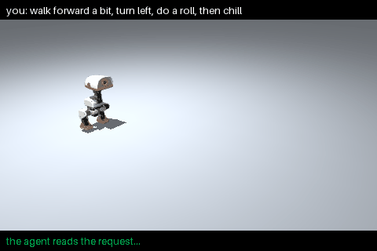

# strands-robots

<div class="sr-hero" markdown>
<div markdown>
<p class="sr-hero__title">Build robots<br>in <em>Python</em>.</p>
<p class="sr-hero__lead">strands-robots is a Python library for building robots: simulation, real hardware, policies and agents. A <code>Simulation</code> is a world, a <code>Robot</code> is a body in that world or on a serial bus, and a <code>Policy</code> turns an observation into an action. The same code drives a simulated robot and a real one, and every robot can be handed to a Strands agent as a tool.</p>
<div class="sr-hero__actions">
<a class="sr-btn sr-btn--primary" href="quickstart/">Quickstart</a>
<a class="sr-btn" href="install/">Installation</a>
<span class="sr-install">uv pip install -e ".[mujoco,onnx,mesh]"<button class="sr-copy" data-clipboard-text='uv pip install -e ".[mujoco,onnx,mesh]"'>copy</button></span>
</div>
</div>
<div class="sr-hero__stage" markdown>
<div class="sr-stage" id="hero-stage" data-live="http://127.0.0.1:8090/">

<span class="sr-stage__badge" id="hero-badge">recorded · run a dashboard on :8090 and this goes live</span>
</div>
</div>
</div>

## Core concepts

<div class="sr-pair" markdown>

```python title="A world with two robots"
from strands_robots import Robot

arm = Robot("so101")                  # an SO-101 arm
g1 = Robot("g1", position=[1, 0, 0])  # a Unitree G1 humanoid
assert arm.sim is g1.sim              # both are in the same world
```

```python title="A policy for each robot"
from strands_robots import Policy

g1.run(Policy("holosoma"), seconds=10)       # an ONNX standing policy
arm.run(Policy("lerobot/smolvla_base"))      # a LeRobot checkpoint
arm.run(Policy("zenoh://gpu:7447/smolvla"))  # a LeRobot policy server
```

```python title="Safety"
arm.manifest                  # controls, ranges and safe ranges
arm.estop()                   # latches immediately, from any thread
arm.resume(approved_by="you") # only a named operator clears it
```

```python title="Agent tools"
from strands import Agent

Agent(tools=[arm.tool, arm.sim.tool])(
    "look at the scene, then open the gripper")
```

</div>

## Features

| Area | What the library provides |
|---|---|
| Robot registry | 76 robots by name (arms, hands, humanoids, quadrupeds), MuJoCo Menagerie and `robot_descriptions` models, or your own MJCF/URDF |
| Simulation | MuJoCo on the CPU; Isaac Sim and Newton on a CUDA GPU, behind the same `Simulation` API |
| Hardware | Feetech STS3215 buses (SO-100, SO-101), Unitree DDS (observe), a digital twin of every real robot |
| Policies | plain Python functions, ONNX skills, and LeRobot checkpoints in-process or served over Zenoh |
| Recording | `run(record=...)` writes a LeRobot v3 dataset, in simulation or on hardware |
| Safety | a generated manifest, one safety chain for every outside command, an operator gate for real robots, an e-stop that latches in about 10 ms |
| Mesh | robots discover each other over Zenoh on a LAN or over AWS IoT Core, take remote commands, stream state and share one e-stop |
| Agent tools | `robot.tool`, `sim.tool` and `mesh.tool` for Strands agents, generated from each robot's manifest |
| Dashboard | a browser view of a world: a live 3D twin, joint controls, cameras, an agent chat and e-stops |

## Agents drive robots through tools

An agent receives tools generated from the robot itself. It picks a skill or a target, the policy or the controller
moves the motors, and the safety chain checks every command on the way.

<div class="sr-pair" markdown>
<div markdown>

</div>
<div markdown>

```text
user   walk forward a bit, turn left, do a roll, then stand still

agent  run  velstand vx=0.3        2 s
agent  run  velstand wz=0.8        2 s
agent  run  roulade                3 s
agent  run  velstand (stand still) 2 s
```

A recorded agent turn on Claude Sonnet 4.5 driving the microduck with Pollen Robotics' open ONNX skills.
See [Agent tools](tools.md) for what the tools expose and what an agent cannot do.

</div>
</div>

## Run it locally

```bash
uv venv -p 3.12 && source .venv/bin/activate
uv pip install -e ".[all]"
python -c "from strands_robots import Robot; from strands_robots.dashboard import Dashboard; Dashboard(Robot('so101').sim).serve(port=8090)"
```

With a dashboard listening on `127.0.0.1:8090`, the view at the top of this page switches from the recording to the
live dashboard. See [Dashboard](dashboard.md) for the options.
