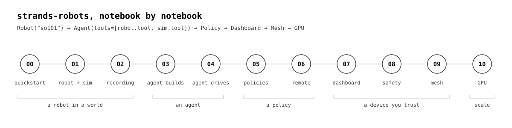

# strands-robots notebooks

Eleven notebooks, saved with their outputs. Each one is also a plain script in [`scripts/`](scripts/) that runs top to
bottom in a terminal or pastes into a REPL.



| # | notebook | you leave with |
|---|---|---|
| 00 | [quickstart](00_quickstart.ipynb) | an SO-101 in a world: observe, act, a camera, a GIF; the agent as code |
| 01 | [robot and sim](01_robot_and_sim.ipynb) | `Robot("so101")` and `Robot("g1")` in one world: observe, act, set_pose, cameras, `Robot.run`, `Simulation.run` |
| 02 | [recording](02_recording.ipynb) | `run(record=...)` to LeRobot v3, reloaded with `LeRobotDataset` |
| 03 | [agent builds a world](03_agent_builds_a_world.ipynb) | `Agent(tools=[sim.tool, robot.tool])` adds objects and cameras from English; `--repl` for `while True: agent(input("> "))` |
| 04 | [agent drives the robot](04_agent_drives_the_robot.ipynb) | the agent moves the arm, runs a policy by name, presses e-stop; the operator gate on a hardware-like arm |
| 05 | [policies](05_policies.ipynb) | `Policy(...)`: a function, ONNX presets (the G1 stands, the duck walks), a Hub ACT in-process, units |
| 06 | [remote inference](06_remote_inference.ipynb) | the same ACT from a real `lerobot-policy-server` over Zenoh, latency from the policy's ledger, a server killed mid-run |
| 07 | [dashboard](07_dashboard.ipynb) | `Dashboard(sim).serve()`: the world in a browser tab, phone and desktop |
| 08 | [device and safety](08_device_and_safety.ipynb) | the manifest, the safety chain, refusals, estop mid-run, resume, the watchdog |
| 09 | [mesh](09_mesh.ipynb) | discover, invoke, state streams, broadcast estop, signed resume, a robot in a second process, `use_mesh` |
| 10 | [GPU backends](10_gpu_backends.ipynb) | Isaac Sim and MuJoCo-Warp, measured on an L40S (shown, not re-run) |

## Run them

From the repository root, Python 3.12:

```bash
uv venv -p 3.12 && source .venv/bin/activate
uv pip install -e ".[all]" ipykernel nbconvert av playwright
uv pip install "lerobot[remote,feetech,dataset] @ git+https://github.com/huggingface/lerobot@53feaef37b67e8f4c23b6953e880ff535e39d6fe"  # 02, 05, 06
playwright install chromium                                                                    # 07
python notebooks/scripts/00_quickstart.py        # or: jupyter lab notebooks/
```

The LeRobot commit is the one `strands_robots/_extras.py` names (LeRobot's PyPI release predates `remote_inference`).
03 and 04 call a model; they use Amazon Bedrock when `AWS_BEARER_TOKEN_BEDROCK` (or AWS credentials) is set.

## Editing

The script is the source; the notebook is generated from it, then executed:

```bash
python notebooks/_nb.py build notebooks/scripts/NN_x.py
jupyter nbconvert --to notebook --execute --inplace notebooks/NN_x.ipynb
```

`_nb.py` holds the builder and a few display helpers (GIFs, inline MP4, tables, quiet imports); `scripts/check_nb.py NN_x.ipynb`
lists any error or stderr output. Neither is part of the package. [`examples/agent_builds_a_scene.py`](examples/agent_builds_a_scene.py)
is the one-file agent example the test suite runs.
